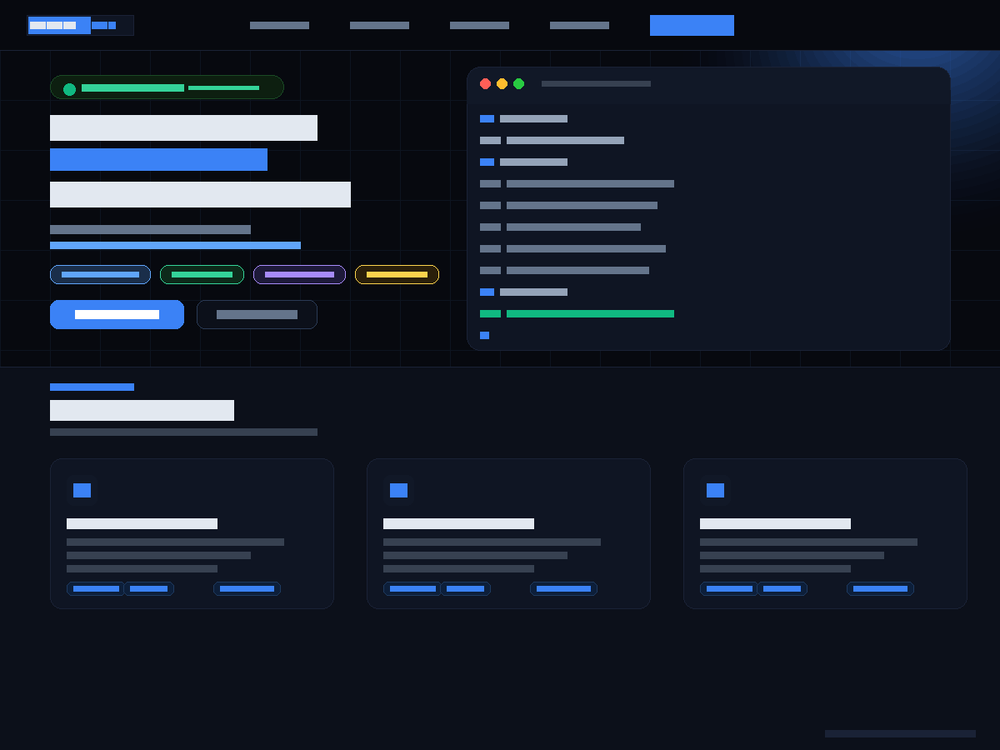

# MondoBarry Portfolio — thème WordPress

Thème WordPress one-page, sombre, pour portfolio de développeur ou d'admin système.
Tout le contenu se règle depuis **Apparence → Personnaliser**, sans toucher au code.



Démo en production : [mondobarry.com](https://mondobarry.com)

## Fonctionnalités

- **Hero** avec terminal animé (`whoami`, compétences, statut) et pastilles de secteurs configurables
- **Sections** Compétences, Projets, Expérience (timeline), Infrastructure, Contact, Musique — chacune activable/désactivable
- **Custom Post Types** `Projets` et `Expériences` avec meta boxes (stack, URL, statut live/en cours, mise en avant) ; repli sur les réglages du Customizer s'ils sont vides
- **Typographie** : 10 polices Google Fonts + 6 monospace, chargées dynamiquement selon le choix
- **Couleurs** via variables CSS injectées depuis le Customizer
- **Formulaire de contact AJAX** : nonce WordPress, sanitization, honeypot anti-spam, envoi via `wp_mail()`
- **Tracking optionnel** : GA4, Google Tag Manager, AdSense, Facebook Pixel (injectés seulement si l'ID est renseigné)
- Nettoyage du `<head>` (générateur, RSD, WLW, shortlink)

## Installation

1. Copier le dossier dans `wp-content/themes/mondobarry-theme`
2. Activer le thème dans **Apparence → Thèmes**
3. Personnaliser dans **Apparence → Personnaliser → 🎨 MondoBarry — Réglages**

Prérequis : WordPress 6.0+, PHP 8.0+.

## Structure

```
functions.php            Setup, enqueue, CSS dynamique, Customizer, AJAX, CPT
customizer-content.php   Contenu éditable des sections
index.php                Page one-page
singular.php / 404.php   Articles, pages, erreur
assets/css/main.css      Styles
assets/js/main.js        Reveal au scroll, menu mobile, formulaire AJAX
```

## Auteur

**Mamadou Alimou Barry** — développeur WordPress depuis 2014 · [mondobarry.com](https://mondobarry.com)

## Licence

GPL v2 ou ultérieure — voir [LICENSE](LICENSE).
